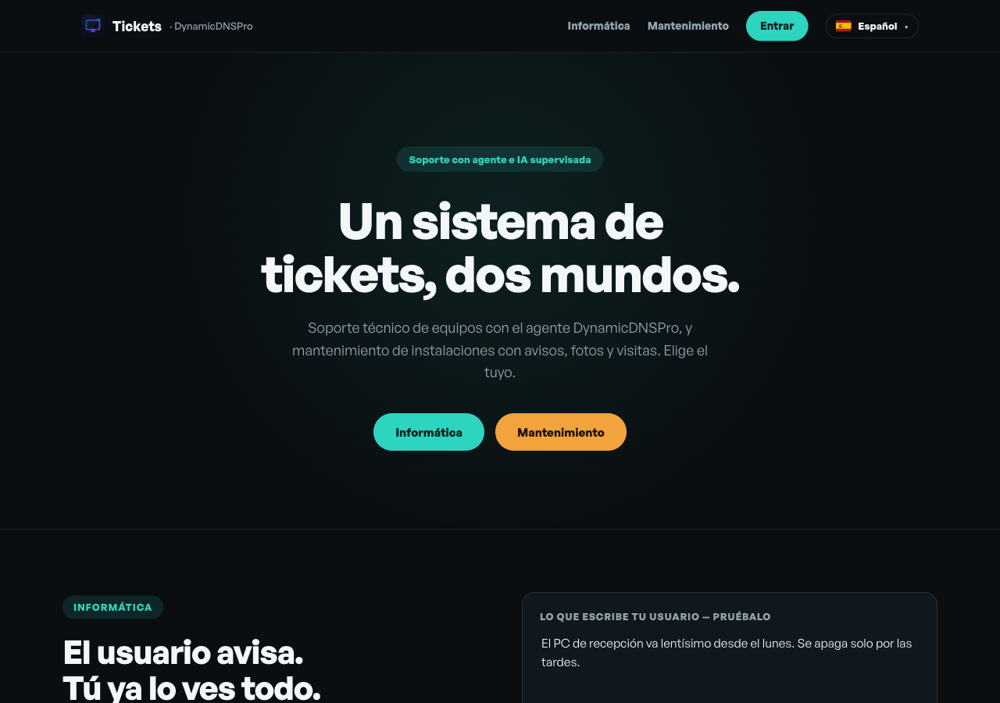

  

<h1 align="center">DynamicDNSPro Tickets</h1>

Soporte técnico con agente en el equipo. Tickets de soporte, terminal en vivo, IA supervisada y avisos — desde el panel web o desde la propia app.

  
  
  
  

🌍 <strong>🇪🇸 Español</strong> · <a href="README.md">🇬🇧 English</a> · <a href="README.de.md">🇩🇪 Deutsch</a> · <a href="README.fr.md">🇫🇷 Français</a> · <a href="README.it.md">🇮🇹 Italiano</a> · <a href="README.pt.md">🇵🇹 Português</a>

> **Este repositorio solo publica releases binarias oficiales** — el código fuente es privado. Descargas firmadas y feeds de auto-actualización.

## Descarga

| | |
|---|---|
|  **Tickets (Windows)** | [DynamicDNSPro-Tickets-Setup.exe](https://github.com/mavksoft/dynamicdnspro-tickets-releases/releases/latest/download/DynamicDNSPro-Tickets-Setup.exe) — siempre la última versión estable |
|  **Web** | [tickets.dynamicdnspro.com](https://tickets.dynamicdnspro.com) — portal del cliente, planes y gestión |

En equipos con el **Agente DynamicDNSPro** no hace falta instalador: activa Tickets en el equipo (o en toda la cuenta) y la app se despliega sola.

## Qué es

DynamicDNSPro Tickets es el módulo de soporte técnico del ecosistema DynamicDNSPro. Cada equipo cliente ejecuta la app de Tickets: los usuarios abren tickets desde la bandeja del sistema y los técnicos responden desde el panel web — con terminal en vivo en el equipo, sugerencias de IA supervisada, ejecución remota de comandos y avisos a sedes o departamentos completos.

## Características

- **Tickets por equipo** — los usuarios abren y siguen tickets desde la app de bandeja; cada ticket queda ligado a su equipo y sede.
- **Terminal en vivo** — ejecuta cmd/PowerShell en el equipo cliente desde el panel, con la salida visible para el usuario.
- **IA supervisada** — respuestas sugeridas y asistencia con comandos para técnicos (Pro+).
- **Comandos remotos** — ejecuta comandos validados como SYSTEM sin interrumpir al usuario (Pro+).
- **Avisos** — comunicados a sedes o departamentos completos con confirmación de lectura.
- **Vista del equipo** — hardware, servicios y estado del equipo del ticket en la misma pantalla (Básico+).
- **Base de conocimiento** — respuestas reutilizables y documentación interna (Pro+).
- **Marca blanca** — tu marca dentro de la app (Business).
- **Roles** — permisos de técnico: ver, atender, ejecutar, admin.
- **Seis idiomas** — portal y app en ES / EN / FR / IT / DE / PT.

## Cómo se usa

1. Regístrate o contrata un plan en [tickets.dynamicdnspro.com](https://tickets.dynamicdnspro.com) (el plan Gratis cubre hasta 5 equipos).
2. **Equipos con el Agente**: activa Tickets en el equipo — la app se instala sola en minutos, sin descargar nada.
3. **Equipos sueltos**: instala `DynamicDNSPro-Tickets-Setup.exe` y vincúlalo con el token de enlace que aparece en *Ajustes* del panel.
4. Invita a tus técnicos, asigna roles y empieza a atender tickets — con terminal, IA y comandos remotos en los planes de pago.

## Ediciones y precios

| Plan | Precio | Equipos | Incluye |
|---|---|---|---|
| **Gratis** | 0 € | 5 | Tickets, terminal en vivo, avisos |
| **Básico** | 6 €/mes · 60 €/año | Ilimitados | Todo lo de Gratis + vista del servidor del equipo |
| **Pro** | 12 €/mes · 120 €/año | Ilimitados | + IA supervisada, comandos remotos, base de conocimiento |
| **Business** | 24 €/mes · 240 €/año | Ilimitados | + marca blanca (tu marca en la app) |

## Requisitos

Windows 10/11 x64 · Acceso a Internet hacia `tickets.dynamicdnspro.com` · Para vincular, el token de enlace de *Ajustes* (instalaciones sueltas) o el Agente DynamicDNSPro (despliegue automático).

## Qué hay en este repositorio

- `DynamicDNSPro-Tickets-Setup-<versión>.exe` — instalador de Windows versionado
- `DynamicDNSPro-Tickets-Setup.exe` — copia de nombre estable que apunta a la última release
- `version.json` — feed de auto-actualización (`tickets_url` / `tickets_size`) servido por el portal

[Última release](https://github.com/mavksoft/dynamicdnspro-tickets-releases/releases/latest)

## FAQ

**¿Necesito este instalador en equipos con el Agente DynamicDNSPro?**  
No — activa Tickets en el equipo desde el panel y el agente despliega la app automáticamente por el canal firmado de fleet.

**¿Cómo se vinculan los equipos sueltos a mi cuenta?**  
Tras instalar, la app pide el token de enlace que se muestra en *Ajustes → Tokens* de tu portal de tickets.

**¿Qué incluye el plan Gratis?**  
Tickets, terminal en vivo y avisos para hasta 5 equipos — sin tarjeta.

## Soporte

- Web y portal del cliente: [tickets.dynamicdnspro.com](https://tickets.dynamicdnspro.com)
- Email: support@it-systems.es

---

DynamicDNSPro Tickets · © MavkSoft / IT-Systems

